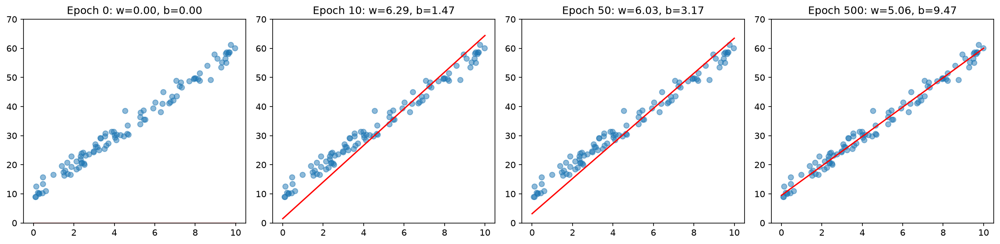
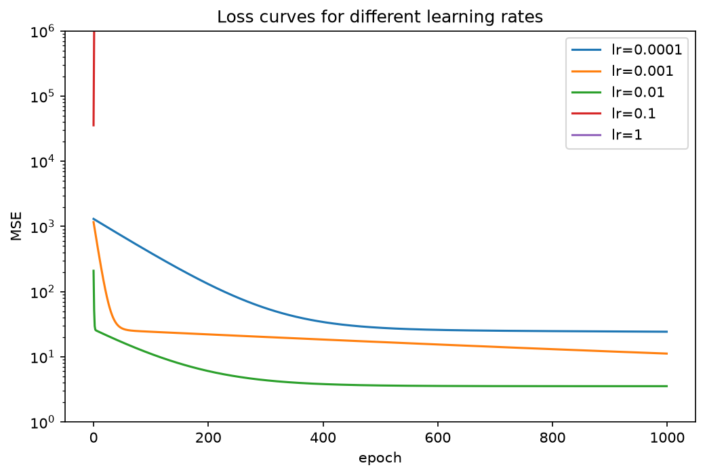

# Linear Regression from Scratch

Linear regression trained with gradient descent in pure NumPy, verified against scikit-learn on synthetic data and California housing.



## The math

$$\hat{y} = Xw + b \qquad L = \frac{1}{n}\sum(\hat{y} - y)^2$$

$$\frac{\partial L}{\partial w} = \frac{2}{n}X^\top(\hat{y} - y) \qquad \frac{\partial L}{\partial b} = \frac{2}{n}\sum(\hat{y} - y)$$

## Results

**Synthetic data** ($y = 5x + 10$ + noise): learned $w = 4.968$, $b = 10.037$, matching scikit-learn to 4 decimal places.

**California housing** (after standardizing the features):

| Model | Test MSE | Test $R^2$ |
|---|---|---|
| Mine | 0.555 | 0.577 |
| scikit-learn | 0.556 | 0.576 |



## Run it

```bash
pip install -r requirements.txt
```

Then open `experiments.ipynb`. The model is in `linreg.py`.

## What I learned

- How to derive gradients by hand and check them numerically
- Too large a learning rate makes training diverge, not just slow down
- Features on different scales need standardizing before gradient descent works
- Silent broadcasting bugs: always check array shapes
